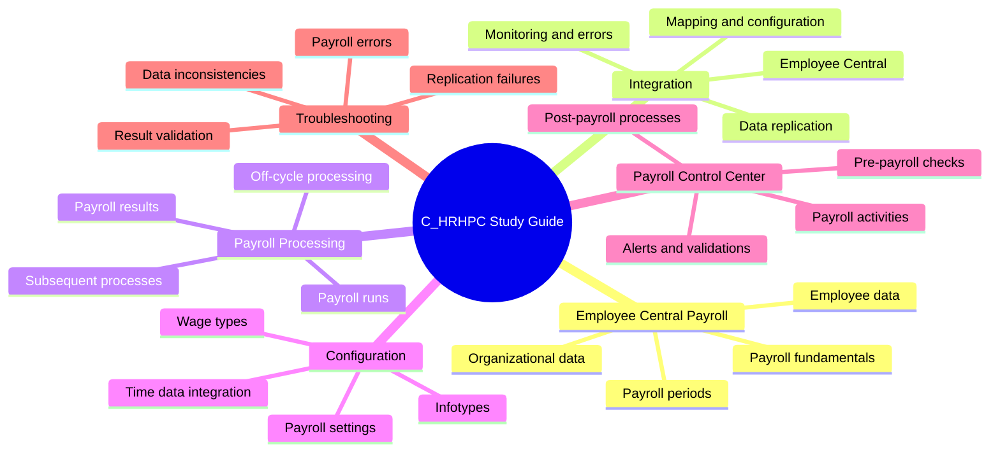
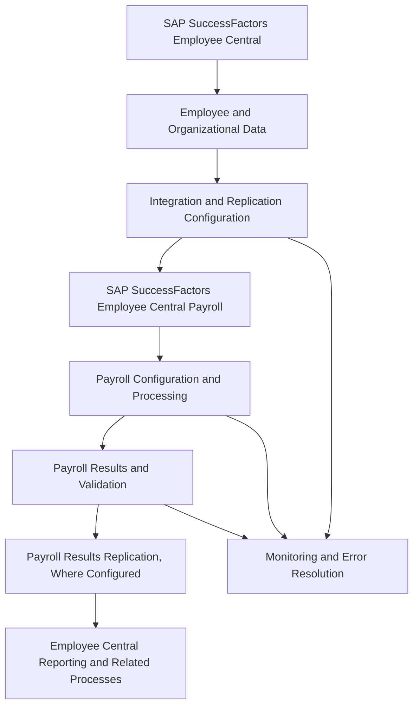
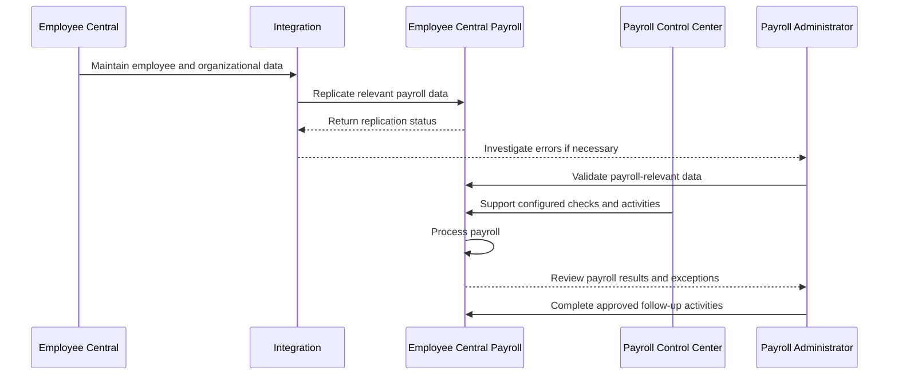
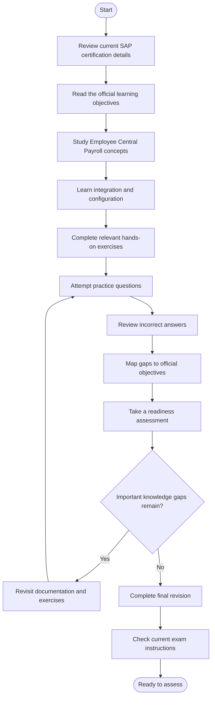
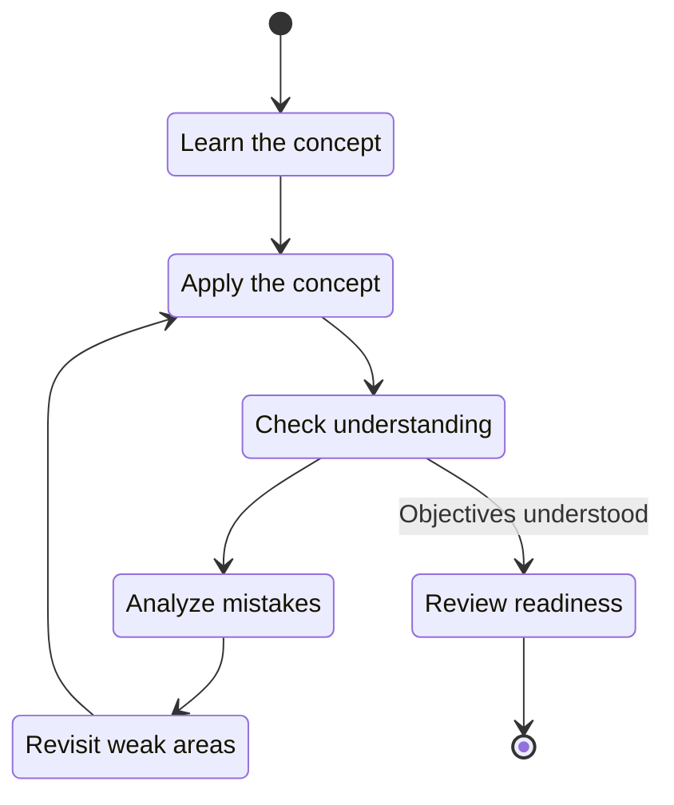
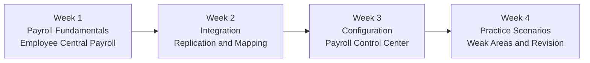

# SAP C_HRHPC Study Guide — SuccessFactors Employee Central Payroll

A practical preparation guide for the **SAP Certified – Implementation Consultant – SAP SuccessFactors Employee Central Payroll (C_HRHPC)** certification.

This repository organizes the technical concepts, integration workflows, configuration topics, practice exercises, and revision strategies that learners can use to prepare for SAP SuccessFactors Employee Central Payroll.

The focus is on understanding how employee data reaches payroll, how payroll processes are configured and monitored, and how consultants investigate common integration and processing issues.

- **Certification code:** C_HRHPC
- **Certification version listed by CertsGate:** C_HRHPC_2601
- **Certification provider:** SAP
- **Primary learning path:** [Configuring SAP SuccessFactors Employee Central Payroll](https://learning.sap.com/learning-journeys/configuring-sap-successfactors-employee-central-payroll-1)
- **Supplementary preparation:** [CertsGate C_HRHPC](https://certsgate.com/exams/sap/c_hrhpc)

## Table of Contents

- [About the Certification](#about-the-certification)
- [Who Should Prepare for C_HRHPC?](#who-should-prepare-for-c_hrhpc)
- [Core Knowledge Areas](#core-knowledge-areas)
- [Official Exam Objectives and Weightings](#official-exam-objectives-and-weightings)
- [Employee Central Payroll Architecture](#employee-central-payroll-architecture)
- [Payroll Processing Workflow](#payroll-processing-workflow)
- [Certification Preparation Flowchart](#certification-preparation-flowchart)
- [Circular Study and Revision Cycle](#circular-study-and-revision-cycle)
- [Step-by-Step Preparation Guide](#step-by-step-preparation-guide)
- [Suggested Study Roadmap](#suggested-study-roadmap)
- [Practice Questions and Mock Tests](#practice-questions-and-mock-tests)
- [Hands-On Learning Projects](#hands-on-learning-projects)
- [Common Preparation Mistakes](#common-preparation-mistakes)
- [Career Relevance](#career-relevance)
- [Frequently Asked Questions](#frequently-asked-questions)
- [Official and Additional Resources](#official-and-additional-resources)
- [About CertsGate](#about-certsgate)

## About the Certification

SAP SuccessFactors Employee Central Payroll supports payroll processing in an environment integrated with SAP SuccessFactors Employee Central. Employee Central serves as the employee-data system of record for this integration, while Employee Central Payroll handles payroll-related processing.

The C_HRHPC certification is listed by CertsGate as **SAP Certified – Implementation Consultant – SAP SuccessFactors Employee Central Payroll**. Candidates should use the current SAP certification page to confirm the exact title and requirements for the assessment they intend to take.

Relevant preparation subjects include:

- Employee Central Payroll configuration.
- Integration between Employee Central and Employee Central Payroll.
- Employee and organizational data replication.
- Payroll processing and payroll administration.
- Payroll Control Center and payroll monitoring.
- Payroll-related troubleshooting and validation.
- Off-cycle and subsequent payroll processes, where applicable to the current learning objectives.

The best starting point is SAP's [Configuring SAP SuccessFactors Employee Central Payroll learning journey](https://learning.sap.com/learning-journeys/configuring-sap-successfactors-employee-central-payroll-1).

## Who Should Prepare for C_HRHPC?

This guide is intended for:

- SAP SuccessFactors Employee Central Payroll implementation consultants.
- SAP HCM and payroll professionals moving into Employee Central Payroll.
- SAP SuccessFactors administrators and support consultants.
- HR technology specialists involved in employee-data and payroll integrations.
- Learners who want a structured revision resource for C_HRHPC.

A background in SAP HCM Payroll is helpful. SAP's official learning journey recommends prior payroll knowledge, including the relevant SAP HCM Payroll learning, before progressing into Employee Central Payroll configuration.

If you are new to payroll, first build a foundation in payroll terminology, employee master data, wage types, payroll periods, and payroll processing. These concepts make the integration and configuration material easier to understand.

## Core Knowledge Areas

The following mind map is an **independent study overview**, not an official SAP exam-domain breakdown or weighting chart.

### 1. Employee Central Payroll Fundamentals

Understand the purpose of Employee Central Payroll and its relationship with Employee Central. Learn which system owns employee information, which data must be available to payroll, and why data quality matters before a payroll run.

### 2. Employee Central Integration

Study the integration between Employee Central and Employee Central Payroll. Focus on the flow of employee and organizational information, replication configuration, field and value mapping, monitoring, and troubleshooting.

### 3. Payroll Configuration

Review the configuration concepts covered in the official learning materials, including wage types, infotypes, payroll-related settings, and relevant time-data integration. Learn how these settings affect the information available for payroll processing.

### 4. Payroll Processing and Results

Understand the purpose of a payroll run, the importance of accurate employee data, and the checks performed before results are accepted. Learn how subsequent payroll activities and off-cycle processes fit into the wider payroll lifecycle.

### 5. Payroll Control Center

Study how Payroll Control Center can help organize payroll activities, evaluate data quality, identify alerts, and coordinate pre-payroll, productive payroll, and post-payroll work.

### 6. Troubleshooting and Validation

Learn to trace an issue from its symptoms to the relevant configuration, data, or processing step. Good troubleshooting involves examining available logs and monitoring information, validating employee data, and confirming that corrections resolve the underlying problem.

## Official Exam Objectives and Weightings

Use the current SAP certification details page to identify the authoritative exam scope. SAP's certification program provides exam-specific information and links to relevant learning resources.

| Information | How to verify it |
|---|---|
| Current certification title | SAP certification details page |
| Exam code and version | Current SAP certification listing |
| Official objectives | Certification page and linked learning journey |
| Topic weightings | Current exam topic-area information, when published |
| Assessment format | Current certification details |
| Duration and passing requirements | Current certification details |
| Prerequisites | Official learning journey and certification guidance |

**No official C_HRHPC domain percentages are assigned in this repository.** The knowledge map above is a learning aid, not a representation of official exam weights. Do not treat the order or size of its sections as a prediction of assessment coverage.

Start with SAP's [certification catalog](https://learning.sap.com/certifications) and the [Employee Central Payroll learning journey](https://learning.sap.com/learning-journeys/configuring-sap-successfactors-employee-central-payroll-1). Build your final checklist from the current official information.

## Employee Central Payroll Architecture

The following diagram presents a simplified conceptual view of the integration. It is intended to explain the relationship between the systems, not to prescribe a single technical implementation.

### Main components

| Component | Purpose |
|---|---|
| Employee Central | Maintains employee information and HR events for the integrated landscape |
| Employee Central Payroll | Supports payroll processing and related payroll activities |
| Replication configuration | Controls how relevant data is transferred and mapped between systems |
| Payroll configuration | Defines the settings needed to process payroll correctly |
| Payroll Control Center | Helps organize payroll activities and monitor issues when implemented |
| Monitoring and validation | Helps identify errors, verify data consistency, and confirm processing results |

The exact components and data flows depend on the implementation. Review the applicable SAP documentation before applying any configuration or troubleshooting procedure.

## Payroll Processing Workflow

Payroll is not just the calculation step. It also involves preparing employee data, checking errors, processing payroll, reviewing results, and completing relevant follow-up activities.

The following is an illustrative process for study purposes. Actual payroll steps depend on the organization's configuration and applicable legal and business requirements.

### Why this workflow matters

A payroll problem may originate before the payroll run begins. For example, missing employee data or incorrect mapping can affect downstream processing. Repeating a payroll run without investigating the underlying data or configuration may not resolve the problem.

For preparation, learn to identify the stage where an issue occurs and which system or configuration area should be investigated first.

## Certification Preparation Flowchart

Use this process to structure your C_HRHPC preparation from the official objectives through final revision.

Do not move on simply because you have finished reading a topic. Check whether you can explain the concept, recognize common configuration issues, and apply your understanding to a practical scenario.

## Circular Study and Revision Cycle

A strong C_HRHPC study routine repeats learning, practice, evaluation, and correction.

For example, after studying data replication, try explaining the data flow, work through a relevant exercise, and identify any point you cannot explain confidently. Return to the official documentation, correct the gap, and test yourself again.

## Step-by-Step Preparation Guide

### Step 1: Review the Official Learning Journey

Begin with [Configuring SAP SuccessFactors Employee Central Payroll](https://learning.sap.com/learning-journeys/configuring-sap-successfactors-employee-central-payroll-1).

Read the learning objectives and prerequisites. Create a checklist of the concepts and practical activities included in the current material. Use the official scope to decide what to study rather than relying on an old third-party outline.

### Step 2: Strengthen Payroll Fundamentals

Review payroll terminology and the role of employee master data, organizational data, wage types, payroll periods, and payroll results.

Make sure you understand why accurate data is essential. Payroll configuration cannot compensate for missing or incorrect information that should have been supplied or replicated correctly.

### Step 3: Study Employee Central Integration

Focus on the relationship between Employee Central and Employee Central Payroll.

Learn how relevant employee data is replicated, where mapping and configuration are involved, and how administrators identify replication problems. Review the official course on [Implementing SAP SuccessFactors Integration with Employee Central Payroll](https://learning.sap.com/courses/implementing-sap-successfactors-integration-with-employee-central-payroll).

### Step 4: Review Configuration Topics

Use the official learning material to study relevant configuration areas, such as wage-type processing, infotype mapping, organizational data, and time-data integration where applicable.

For each setting, write down its purpose, the data it affects, and the types of issues that may occur if it is configured incorrectly.

### Step 5: Understand Payroll Processing

Learn the relationship between payroll preparation, payroll execution, results review, and subsequent activities.

Understand how administrators identify exceptions and why corrections should be validated before results are treated as final.

### Step 6: Study Payroll Control Center

Review the role of Payroll Control Center in organizing payroll activities, supporting checks, and monitoring data quality. Focus on how configured activities and alerts help payroll teams identify problems before or during processing.

Use SAP's [Payroll Control Center course](https://learning.sap.com/courses/sap-successfactors-payroll-control-center) for guided learning.

### Step 7: Practice Troubleshooting

Work through scenarios involving missing employee data, replication errors, incorrect mappings, payroll exceptions, and unexpected results.

Follow a consistent approach:

1. Identify the symptom.
2. Determine which process or system is involved.
3. Review the available monitoring information.
4. Check relevant data and configuration.
5. Correct the underlying issue in an authorized environment.
6. Validate the result and document the cause.

### Step 8: Assess Your Readiness

Use practice questions to find weak areas and review the official objectives one last time. You should be able to explain the relevant concepts in your own words, reason through scenarios, and understand why alternative solutions may be unsuitable.

Before the assessment, confirm the current format, duration, and technical requirements through SAP.

## Suggested Study Roadmap

This four-week schedule is an independent planning suggestion, not an official SAP preparation timetable. Adjust it to your experience and the current exam objectives.

| Week | Main focus | Suggested outcome |
|---|---|---|
| 1 | Payroll fundamentals and system roles | Explain how Employee Central Payroll fits into the HR landscape |
| 2 | Employee Central integration and replication | Describe data flow, mapping, and basic troubleshooting |
| 3 | Configuration and Payroll Control Center | Understand relevant settings and payroll activity management |
| 4 | Practice questions and revision | Identify remaining gaps and check readiness |

A practical routine is to study a concept, summarize it in your own words, perform an exercise when an appropriate system is available, and then test your understanding.

If you already work with Employee Central Payroll, spend less time rereading familiar concepts and more time reviewing the official objectives and areas where your practical experience is limited.

## Practice Questions and Mock Tests

Practice questions are useful when they help you understand why a solution works. They are less useful when you memorize an answer without understanding the payroll process behind it.

The following are **original learning questions**, not actual or official SAP certification questions.

### Question 1: What is the primary role of Employee Central in an Employee Central Payroll integration?

A. It replaces all payroll processing functions.  
B. It serves as the employee-data system of record for the integration.  
C. It automatically resolves every payroll exception.  
D. It removes the need for employee-data replication.

**Answer:** B.

**Explanation:** Employee Central serves as the employee-data system of record in this integration. Relevant payroll data must be made available to Employee Central Payroll through the configured integration.

### Question 2: An employee's payroll-relevant data is missing in Employee Central Payroll. What should an administrator do first?

A. Repeat payroll processing without investigation.  
B. Assume the payroll engine is defective.  
C. Investigate the source data, replication status, and relevant configuration.  
D. Delete the employee record from both systems.

**Answer:** C.

**Explanation:** Start by tracing the issue through the data flow. Check whether the information exists in the source, whether replication completed, and whether the relevant mapping and configuration are correct. Follow the supported troubleshooting procedure for the actual environment.

### Question 3: What is a key purpose of Payroll Control Center?

A. To replace all HR master-data maintenance.  
B. To eliminate payroll configuration.  
C. To help organize payroll activities and support monitoring and validation.  
D. To guarantee that every payroll run completes without errors.

**Answer:** C.

**Explanation:** Payroll Control Center can help teams manage payroll activities and identify issues through configured monitoring and validation. It does not remove the need for accurate data, correct configuration, or appropriate payroll controls.

### How to use practice questions effectively

1. Answer the question before reviewing the explanation.
2. Explain why the selected answer is correct.
3. Identify why the other options do not fit the scenario.
4. Link the mistake to an official learning objective.
5. Revisit the relevant documentation or complete a practical exercise.
6. Try a new scenario to verify that you understand the concept.

A mock test can help identify knowledge gaps, but a score alone does not establish readiness. Combine assessment results with your ability to explain workflows and troubleshoot realistic scenarios.

For supplementary practice material, visit [CertsGate C_HRHPC](https://certsgate.com/exams/sap/c_hrhpc). Compare any third-party explanations with current SAP documentation and the official certification scope.

## Hands-On Learning Projects

The following projects are independent practice activities. They are not represented as official exam tasks.

### Project 1: Map the Employee Data Flow

Create a diagram showing how employee and organizational data moves from Employee Central into Employee Central Payroll.

Include the source, replication process, target system, monitoring points, and the steps an administrator might take when replication fails.

**Learning goal:** Explain the integration and identify where a data issue should be investigated.

### Project 2: Create a Payroll Readiness Checklist

Draft a checklist for a hypothetical payroll period.

Include employee-data completeness, relevant replication status, payroll configuration, unresolved exceptions, and the appropriate pre-payroll checks for the scenario.

**Learning goal:** Understand why payroll preparation requires more than simply starting a payroll run.

### Project 3: Investigate a Replication Error

Write a troubleshooting scenario in which an employee update is not reflected in Employee Central Payroll.

Document the symptoms, information to inspect, possible causes, appropriate corrective actions, and validation steps.

**Learning goal:** Develop a systematic troubleshooting method instead of relying on guesswork.

### Project 4: Design a Payroll Control Center Activity Flow

Create a conceptual flow for pre-payroll checks, productive payroll processing, and post-payroll activities.

Show how alerts or validation steps could identify issues and how a payroll administrator would review them.

**Learning goal:** Understand the relationship between payroll activity management, monitoring, and operational controls.

### Project 5: Build a Payroll Validation Checklist

Prepare a checklist for reviewing payroll results in an authorized training environment. Include relevant exception review, result validation, follow-up processing, and documentation.

**Learning goal:** Recognize the importance of validating payroll outcomes before completing the relevant business process.

Use training systems and follow the procedures applicable to the actual SAP release. Do not experiment with payroll configuration or employee data in production without authorization.

## Common Preparation Mistakes

### Memorizing terms without understanding data flow

Knowing the names of Employee Central, Employee Central Payroll, and Payroll Control Center is not enough. Be able to explain how the components relate and what happens when one stage fails.

### Treating replication as an automatic, error-free process

Integration depends on relevant configuration, mapping, data quality, and supported procedures. Learn how to investigate failures instead of assuming that every employee update will arrive correctly.

### Ignoring payroll fundamentals

Wage types, employee data, payroll periods, and payroll results are important building blocks. Weak fundamentals make advanced configuration and troubleshooting harder to understand.

### Confusing monitoring with correction

A monitoring tool can help reveal an issue, but the underlying cause still needs investigation and correction. Understand the difference between identifying an error and resolving it.

### Relying entirely on mock tests

Practice questions can reveal gaps, but they cannot replace official learning materials or relevant hands-on work. Use incorrect answers to guide your revision.

### Studying from outdated documentation

SAP products and configuration procedures evolve. Confirm that a resource applies to the relevant release and check current official materials before relying on old instructions.

## Career Relevance

Knowledge of SAP SuccessFactors Employee Central Payroll can support roles involving:

- SAP SuccessFactors implementation consulting.
- Employee Central Payroll configuration.
- Payroll administration and application support.
- HR system integration.
- Payroll data quality and troubleshooting.
- Payroll process monitoring and validation.
- SAP HCM and HR technology projects.

The practical value of certification depends on your experience, the requirements of the roles you pursue, and your ability to apply the knowledge in real implementations. Combine structured exam preparation with practical understanding of payroll processes and system integration.

## Frequently Asked Questions

### What is the C_HRHPC certification?

C_HRHPC is listed as SAP Certified – Implementation Consultant – SAP SuccessFactors Employee Central Payroll. Confirm the current certification title and version on SAP's certification platform before preparing for a specific assessment.

### What should I study for C_HRHPC?

Start with the official Employee Central Payroll learning journey. Relevant learning areas include payroll fundamentals, Employee Central integration, employee-data replication, configuration, payroll processing, Payroll Control Center, and troubleshooting. Use the current official objectives to determine the exact assessment scope.

### Do I need SAP HCM Payroll knowledge?

SAP recommends prior HCM Payroll knowledge for its Employee Central Payroll configuration learning journey. If you are unfamiliar with payroll fundamentals, study those first.

### What is the difference between Employee Central and Employee Central Payroll?

Employee Central serves as the employee-data system of record for this integration. Employee Central Payroll supports payroll processing and related payroll activities. The systems have distinct responsibilities and interact through configured integration processes.

### What is Payroll Control Center?

Payroll Control Center supports the organization and monitoring of payroll activities. Depending on the implementation, it can help teams manage pre-payroll checks, productive payroll, post-payroll activities, and relevant alerts or validations.

### How long should I study for C_HRHPC?

Preparation time depends on your existing SAP HCM Payroll knowledge, Employee Central experience, integration experience, and progress against the current official objectives. The four-week roadmap in this guide is only a suggested structure.

### Are the exam format, duration, and passing score listed here?

No current assessment values are assumed in this README. Check the official certification details for the applicable format, duration, and other requirements.

### Can practice questions replace official SAP learning materials?

No. Use questions to test understanding and find weak areas. Official documentation, structured learning, and appropriate hands-on practice should remain the foundation of preparation.

## Official and Additional Resources

Use SAP resources as the primary reference for product behavior, supported configuration, and certification requirements.

| Resource | Purpose |
|---|---|
| [Configuring SAP SuccessFactors Employee Central Payroll](https://learning.sap.com/learning-journeys/configuring-sap-successfactors-employee-central-payroll-1) | Main learning journey for Employee Central Payroll configuration |
| [Implementing SAP SuccessFactors Integration with Employee Central Payroll](https://learning.sap.com/courses/implementing-sap-successfactors-integration-with-employee-central-payroll) | Employee Central integration and replication concepts |
| [Employee Central Payroll for Payroll Administrators](https://learning.sap.com/courses/sap-successfactors-employee-central-payroll-for-payroll-administrators) | Payroll administration, data management, and process concepts |
| [SAP SuccessFactors Payroll Control Center](https://learning.sap.com/courses/sap-successfactors-payroll-control-center) | Payroll activity management and monitoring |
| [SAP Help Portal](https://help.sap.com/) | Product documentation and implementation guidance |
| [SAP Certification Catalog](https://learning.sap.com/certifications) | Current certification details and preparation information |
| [SAP Certification Support](https://learning.sap.com/helpcenter/certification-support) | Guidance on certification procedures and requirements |
| [CertsGate C_HRHPC](https://certsgate.com/exams/sap/c_hrhpc) | Independent supplementary preparation material |

The official documentation should take priority when a third-party resource conflicts with current SAP guidance.

## About CertsGate

[CertsGate](https://certsgate.com/) is an independent IT certification preparation resource covering multiple technology vendors and certification tracks.

Candidates preparing for C_HRHPC can explore the [CertsGate C_HRHPC page](https://certsgate.com/exams/sap/c_hrhpc) for supplementary study material and practice resources.

Use these materials to reinforce concepts, test your understanding, and identify areas that need further revision. Verify technical explanations against SAP's official learning content and product documentation.
